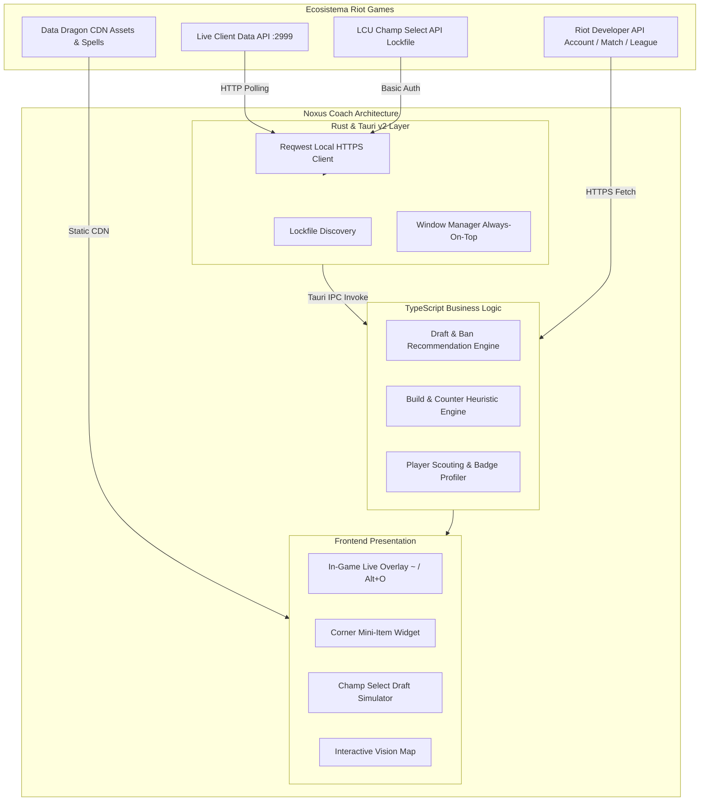

<div align="center">

# ⚔️ NOXUS COACH
### *Asistente Táctico de Alto Rendimiento y Coach In-Game para League of Legends*

[](https://v2.tauri.app/)
[](https://www.rust-lang.org/)
[](https://www.typescriptlang.org/)
[](https://vite.dev/)
[](https://tailwindcss.com/)
[](https://developer.riotgames.com/)
[](https://github.com/Aczino593/Noxus-Coach)
[](LICENSE)

<p align="center">
  <b>Noxus Coach</b> es una plataforma integral de analítica, simulación predictiva de draft y asistencia táctica en tiempo real para <i>League of Legends</i>. Diseñada para jugadores competitivos y analistas, ofrece telemetría de nivel profesional sin penalizar los FPS ni consumir recursos excesivos del sistema.
</p>

[Características](#-características-principales) • [Arquitectura](#-arquitectura-del-sistema) • [Instalación](#-instalación-y-puesta-en-marcha) • [Despliegue](#-despliegue-en-cloudflare-pages) • [Comparativa](#-comparativa-de-rendimiento) • [Cumplimiento](#-cumplimiento-y-juego-limpio)

---

</div>

## 🎯 Visión General

A diferencia de las herramientas comerciales tradicionales basadas en plataformas pesadas como Electron u Overwolf —que saturan la memoria RAM y provocan caídas de frames durante las partidas—, **Noxus Coach** está construido sobre **Tauri v2** y **Rust**. 

Esta arquitectura permite ejecutar una aplicación de escritorio nativa ultraligera (**< 15 MB de binario** y **< 60 MB de memoria RAM**) con un overlay translúcido inmersivo que responde a atajos globales (`~` y `Alt+O`), garantizando **0% de impacto en el rendimiento gráfico** y cumplimiento riguroso de las directivas de seguridad de **Riot Vanguard**.

---

## 🚀 Características Principales

### 1. 🛡️ Draft Coach & Inteligencia de Selección (Flujo Avanzado)
* **Recomendaciones de Baneo Dinámicas en 3 Niveles:**
  * **Counters Directos:** Identifica qué campeones anulan directamente al pick seleccionado (ej. si juegas Ashe: counters como Miss Fortune, Jinx, Maokai, etc.).
  * **Meta del Carril:** Sugerencias optimizadas para tu posición específica (Top, Jungla, Mid, ADC, Soporte).
  * **Prohibición General:** Campeones con mayor tasa de victorias y prioridad del parche actual.
* **Evaluación Heurística 5v5:**
  * Puntuación de draft global y puntuación de fase de líneas.
  * Análisis de maestría, tasa de victoria (*Win Rate*), sinergia promedio y counter promedio.
  * Ratio de daño del equipo (AD % vs AP %) y cálculo de ventaja en juego temprano (*Early Game Advantage*).
* **Encuentros Carril por Carril:** Comparativa directa de los 5 emparejamientos con desglose visual de sinergias y enfrentamientos individuales.
* **Preparador y Fijación de Builds:** Selección de runas y árboles de objetos recomendados con botón interactivo de confirmación (*«Fijar esta build»*).

### 2. ⚡ Overlay Táctico In-Game (Atajos: `~` y `Alt+O`)
* **Pestaña `Game Data`:**
  * **Fase de Líneas Nivel a Nivel (1 al 5):** Diagnóstico estratégico turno a turno con el *Estilo de Juego* recomendado (`Matón`, `Pokeo`, `All-in`), índice de *Tradeo* y nivel de *Amenaza de Muerte*.
  * **Ventaja de Escalado de Equipo:** Proyección temporal de poder dividida en *Inicio (15-26 min)*, *Juego Medio (27-32 min)* y *Juego Tardío (33+ min)*.
  * **Builds Paginadas (1/3):** Objetos de inicio (Doran + pociones), secuencia numerada de compra (1 a 6) y alternativas situacionales reactivas.
  * **Matriz de Subida de Habilidades (1 al 18):** Cuadrícula completa nivel a nivel para Q, W, E y R según la build activa.
  * **Panel Lateral de Matchup:** Estado del carril (0-7 min) y emparejamientos individuales del mapa.
* **Pestaña `Player Scouting`:**
  * Tarjetas de los **10 jugadores de la partida** (aliados y rivales) mostrando Nombre, `#Tag`, Rango SoloQ y LP, Win Rate general, Win Rate con el campeón y etiquetas psicológicas de estilo de juego:
    * 🟢 *Verde:* `Visión Omnisciente`.
    * 🔵 *Cian:* `Juego agresivo en primeras fases`, `Luchas constantes`, `A menudo haciendo ganks`, `Normalmente «Split-Pushes»`.
    * 🟣 *Púrpura:* `[Campeón] Monstruo`, `[Campeón] Jugador`, `Sin partidas recientes`.
    * 🔴 *Rojo:* `Bastante vulnerable al principio`, `Vulnerable al principio`, `Peleas poco frecuentes`.
* **Mini-Widget de Tienda en Esquina Inferior:**
  * Módulo ultracompacto anclado en la esquina inferior derecha. Muestra el **siguiente objeto a completar**, oro en mano, oro faltante, casillas de verificación (`✓`) para componentes adquiridos y una tira de avance de los 6 ítems de la build.
* **Barra de Habilidades sobre el HUD:**
  * Indicador visual dinámico sobre las teclas Q-W-E-R marcando en tiempo real qué tecla subir de nivel.

### 3. 🔌 Conexión Nativa con el Cliente de LoL (LCU & Live Client)
* **Detección Local vía Rust:** Búsqueda automática del archivo `lockfile` de League of Legends en discos `C:`, `D:`, `E:` (Windows), macOS y Linux.
* **Sondeo Pasivo Seguro:** Consulta local bajo demanda de la sesión de draft (`/lol-champ-select/v1/session`) y de telemetría de partida en vivo (`https://127.0.0.1:2999/liveclientdata`).
* **Sin Manipulación de Memoria:** No inyecta código, no modifica la memoria del juego y cumple estrictamente con las políticas de terceros de Riot Games.

### 4. 🗺️ Herramientas de Macro & Fundamentos
* **Mapa Interactivo de Visión:** Ubicaciones estratégicas de centinelas defensivos, ofensivos y de control en objetivos clave (Dragón, Barón, Buffs).
* **Planificador de Objetos Reactivos:** Sugerencias contra arquetipos enemigos (Anti-Tanque, Anti-Curación, Anti-Burst, Anti-Poke).
* **Perfil & Historial Oficial:** Sincronización oficial con endpoints de Riot Games (`Account-v1`, `Summoner-v4`, `League-v4`, `Match-v5`).

---

## 🏗️ Arquitectura del Sistema



---

## 💻 Requisitos del Sistema

| Componente | Requisito Mínimo | Requisito Recomendado |
| :--- | :--- | :--- |
| **Sistema Operativo** | Windows 10/11 (64-bit), macOS 12+, Linux | Windows 11 (64-bit) |
| **Node.js** | v18.0.0 o superior | v20.x LTS |
| **Memoria RAM** | 4 GB | 8 GB o superior |
| **Compilador Rust** | Requerido solo para compilar el instalador nativo | Rustc & Cargo (Edición 2021) |
| **League of Legends** | Instalación oficial de Riot Games | Cualquier región (LAS, LAN, NA, EUW, etc.) |

---

## 📦 Instalación y Puesta en Marcha

### 1. Clonar el Repositorio
```bash
git clone https://github.com/Aczino593/Noxus-Coach.git
cd Noxus-Coach
```

### 2. Instalar Dependencias
```bash
npm install
```

### 3. Configurar Variables de Entorno
Copia el archivo de plantilla `.env.example` a `.env`:

```bash
# Windows (PowerShell)
Copy-Item .env.example .env

# Linux / macOS (Bash)
cp .env.example .env
```

Edita `.env` e introduce tu API Key gratuita de desarrollador de Riot Games:
```env
VITE_RIOT_API_KEY=RGAPI-tu-clave-aqui
```
*(Puedes obtener una clave gratuita en [developer.riotgames.com](https://developer.riotgames.com)).*

---

## 🎮 Modos de Ejecución

### Opción A: Modo Web (Evaluación Instantánea en Navegador)
Permite navegar y probar toda la interfaz, el simulador de draft, las builds y el scouting sin necesidad de tener el cliente de League of Legends abierto:
```bash
npm run dev
```
La aplicación se abrirá en `http://localhost:1420`.

### Opción B: Modo Escritorio Nativo (Tauri v2)
Lanza la aplicación de escritorio con aceleración por hardware y soporte de atajos globales:
```bash
npm run tauri:dev
```

### Opción C: Compilación para Producción
* **Build Web:**
  ```bash
  npm run build
  ```
* **Instalador de Escritorio (.exe para Windows):**
  ```bash
  npm run tauri:build
  ```

---

## 🌐 Despliegue en Cloudflare Pages

El proyecto incluye preconfiguradas las reglas de enrutamiento SPA (`_redirects`) y las directivas de seguridad para Cloudflare Pages (`_headers`):

1. Conecta tu repositorio de GitHub en el panel de **Cloudflare Pages**.
2. Configura los parámetros de compilación:
   * **Framework preset:** `Vite`
   * **Build command:** `npm run build`
   * **Build output directory:** `dist`
3. En **Settings > Environment Variables**, añade:
   * `NODE_VERSION`: `20`
   * `VITE_RIOT_API_KEY`: *(Tu Riot API Key de desarrollo)*
4. Pulsa **Save and Deploy**.

---

## 📊 Comparativa de Rendimiento

| Métrica | Noxus Coach (Tauri v2) | Mobalytics / Blitz (Electron) | Overwolf Apps |
| :--- | :---: | :---: | :---: |
| **Consumo de Memoria RAM** | **~45 - 60 MB** | 450 - 850 MB | 500 - 1.2 GB |
| **Tamaño del Instalador** | **~14 MB** | 120 - 180 MB | 250 MB+ |
| **Impacto en FPS In-Game** | **0% (Sin caídas)** | 5% - 12% | 8% - 15% |
| **Arranque en Frío** | **< 0.8 s** | 4.5 - 9.0 s | 6.0 - 12.0 s |
| **Privacidad & Telemetría** | **100% Local / Open Source** | Publicidad y Rastreo Comercial | Publicidad y Procesos en Segundo Plano |

---

## ⚖️ Cumplimiento y Juego Limpio

**Noxus Coach** fue diseñado bajo el principio de estricto apego a la [Política de Aplicaciones de Terceros de Riot Games](https://developer.riotgames.com/policies/general):

1. **Sin Inyección de Memoria:** No lee ni modifica los archivos binarios del proceso de League of Legends.
2. **Uso de Interfaces Oficiales:** Se comunica exclusivamente a través de la `Live Client Data API` pública y la API oficial del LCU.
3. **Sin Información Oculta:** Toda la información provista corresponde a datos que un jugador puede calcular mentalmente o consultar en fuentes públicas (runas, counters teóricos, estadísticas de parches y cálculo de oro de objetos).
4. **100% Compatible con Riot Vanguard:** No activa alertas de anticheat ni compromete la seguridad de la cuenta del invocador.

---

## 📜 Licencia

Distribuido bajo la Licencia **MIT**. Consulta el archivo `LICENSE` para más información.  
*League of Legends* y *Riot Games* son marcas comerciales registradas de Riot Games, Inc. Noxus Coach no está respaldado por Riot Games ni refleja las opiniones de Riot Games ni de ninguna persona involucrada formalmente en la producción o administración de League of Legends.

<div align="center">
  <sub>Desarrollado con pasión para la comunidad competitiva de LATAM.</sub>
</div>
