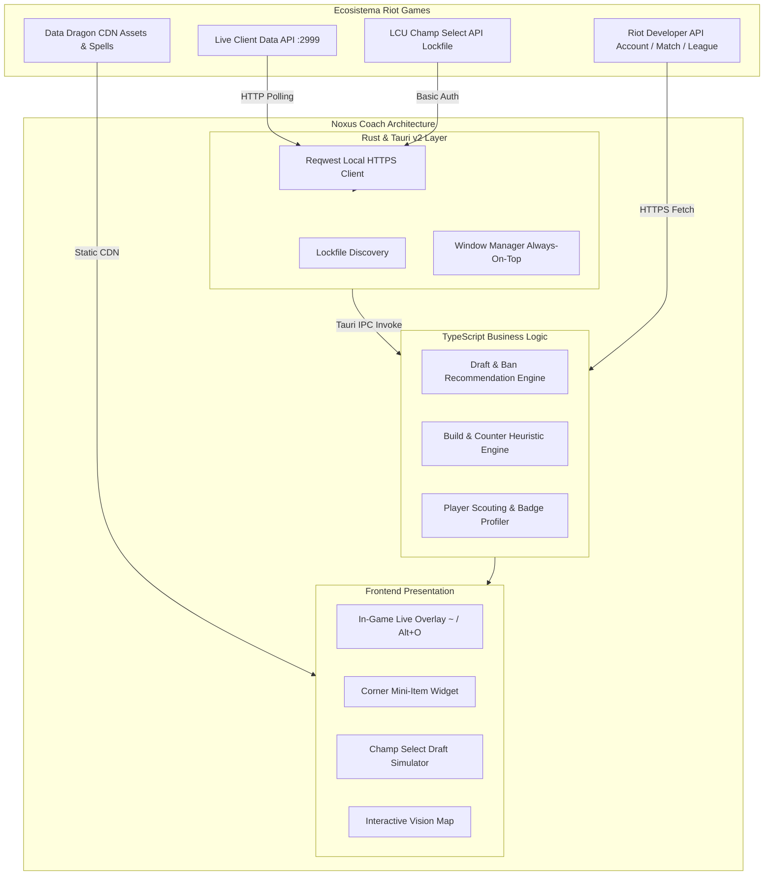

# Noxus Coach

Asistente tactico de alto rendimiento y coach in-game para League of Legends.

[](https://v2.tauri.app/)
[](https://www.rust-lang.org/)
[](https://www.typescriptlang.org/)
[](https://vite.dev/)
[](https://tailwindcss.com/)
[](https://developer.riotgames.com/)
[](https://github.com/Aczino593/Noxus-Coach)
[](LICENSE)

Noxus Coach es una aplicacion integral de analitica, simulacion predictiva de draft y asistencia tactica en tiempo real para League of Legends. Disenada para jugadores competitivos y analistas, ofrece telemetria de nivel profesional sin penalizar los fotogramas por segundo (FPS) ni consumir recursos excesivos del sistema.

---

## Acceso al Proyecto Desplegado

Para ver y probar el proyecto desplegado, utiliza el siguiente enlace:

- Enlace de acceso: https://drive.google.com/drive/folders/1xfBBXQKKK-6ex5ujo4jAk7S5d4s-_2UZ?usp=sharing

---

## Vision General

A diferencia de las herramientas comerciales tradicionales basadas en plataformas pesadas como Electron u Overwolf, que sobrecargan la memoria RAM y provocan caidas de rendimiento durante las partidas, Noxus Coach esta construido sobre Tauri v2 y Rust.

Esta arquitectura permite ejecutar una aplicacion de escritorio nativa ultraligera (menos de 15 MB de binario y menos de 60 MB de memoria RAM) con un overlay translucido que responde a atajos globales (`~` y `Alt + O`), garantizando cero impacto en el rendimiento grafico y cumplimiento riguroso de las directivas de seguridad de Riot Vanguard.

---

## Caracteristicas Principales

### 1. Draft Coach e Inteligencia de Seleccion

- **Recomendaciones de baneo dinamicas en 3 niveles:**
  - *Counters directos:* Identifica que campeones anulan directamente al pick seleccionado (por ejemplo, frente a Ashe: Miss Fortune, Jinx, Maokai, Tristana).
  - *Meta del carril:* Sugerencias optimizadas para la posicion asignada (Top, Jungla, Mid, ADC, Soporte).
  - *Prohibicion general:* Campeones con mayor tasa de victorias y presencia del parche actual.
- **Evaluacion heuristica 5v5:**
  - Puntuacion de draft global y puntuacion de la fase de lineas.
  - Analisis de maestria, tasa de victoria (Win Rate), sinergia promedio y counter promedio.
  - Ratio de dano del equipo (AD % frente a AP %) y calculo de ventaja en juego temprano (Early Game Advantage).
- **Encuentros carril por carril:** Comparativa directa de los 5 emparejamientos con desglose visual de sinergias y duelos individuales.
- **Preparador y fijacion de builds:** Seleccion de runas y arboles de objetos recomendados con boton interactivo de confirmacion ("Fijar esta build").

### 2. Overlay Tactico In-Game (Atajos: ~ y Alt + O)

- **Pestana Game Data:**
  - *Fase de lineas nivel a nivel (1 al 5):* Diagnostico estrategico turno a turno con estilo de juego recomendado (Maton, Pokeo, All-in), indice de tradeo y nivel de amenaza de muerte.
  - *Ventaja de escalado de equipo:* Proyeccion temporal de poder dividida en Inicio (15-26 min), Juego Medio (27-32 min) y Juego Tardio (33+ min).
  - *Builds paginadas (1/3):* Objetos de inicio (Doran y pociones), secuencia numerada de compra (1 a 6) y alternativas situacionales reactivas.
  - *Matriz de subida de habilidades (1 al 18):* Cuadricula completa nivel a nivel para Q, W, E y R segun la build activa.
  - *Panel lateral de matchup:* Estado del carril (0-7 min) y emparejamientos individuales del mapa.
- **Pestana Player Scouting:**
  - Tarjetas de los 10 jugadores de la partida (aliados y rivales) mostrando Nombre, #Tag, Rango SoloQ y LP, Win Rate general, Win Rate con el campeon y etiquetas de estilo de juego:
    - Vision Omnisciente.
    - Juego agresivo en primeras fases, Luchas constantes, Ganks frecuentes, Split-push habitual.
    - Especialista de campeon (Monstruo / Jugador habitual) o Sin partidas recientes.
    - Vulnerabilidad en juego temprano o Baja frecuencia de peleas.
- **Mini-Widget de tienda en esquina inferior:**
  - Modulo ultracompacto anclado en la esquina inferior derecha. Muestra el siguiente objeto a completar, oro en mano, oro faltante, casillas de verificacion para componentes adquiridos y una barra de avance de los 6 items de la build.
- **Barra de habilidades sobre el HUD:**
  - Indicador visual dinamico sobre las teclas Q-W-E-R marcando en tiempo real que tecla subir de nivel.

### 3. Conexion Nativa con el Cliente de LoL (LCU y Live Client)

- **Deteccion local via Rust:** Busqueda automatica del archivo lockfile de League of Legends en discos C:, D:, E: (Windows), macOS y Linux.
- **Sondeo pasivo seguro:** Consulta local bajo demanda de la sesion de draft (`/lol-champ-select/v1/session`) y de telemetria de partida en vivo (`https://127.0.0.1:2999/liveclientdata`).
- **Sin manipulacion de memoria:** No inyecta codigo, no modifica la memoria del juego y cumple estrictamente con las politicas de terceros de Riot Games.

### 4. Herramientas de Macro y Fundamentos

- **Mapa interactivo de vision:** Ubicaciones estrategicas de centinelas defensivos, ofensivos y de control en objetivos clave (Dragon, Baron, Mejoras).
- **Planificador de objetos reactivos:** Sugerencias contra arquetipos enemigos (Anti-Tanque, Anti-Curacion, Anti-Burst, Anti-Poke).
- **Perfil e historial oficial:** Sincronizacion oficial con endpoints de Riot Games (Account-v1, Summoner-v4, League-v4, Match-v5).

---

## Arquitectura del Sistema



---

## Requisitos del Sistema

| Componente | Requisito Minimo | Requisito Recomendado |
| :--- | :--- | :--- |
| **Sistema Operativo** | Windows 10/11 (64-bit), macOS 12+, Linux | Windows 11 (64-bit) |
| **Node.js** | v18.0.0 o superior | v20.x LTS |
| **Memoria RAM** | 4 GB | 8 GB o superior |
| **Compilador Rust** | Requerido solo para compilar el binario nativo | Rustc y Cargo (Edicion 2021) |
| **League of Legends** | Instalacion oficial de Riot Games | Cualquier region (LAS, LAN, NA, EUW, etc.) |

---

## Instalacion y Puesta en Marcha

### 1. Clonar el repositorio
```bash
git clone https://github.com/Aczino593/Noxus-Coach.git
cd Noxus-Coach
```

### 2. Instalar dependencias
```bash
npm install
```

### 3. Configurar variables de entorno
Copia el archivo de plantilla `.env.example` a `.env`:

```bash
# Windows (PowerShell)
Copy-Item .env.example .env

# Linux / macOS (Bash)
cp .env.example .env
```

Edita `.env` e introduce tu API Key gratuita de desarrollador de Riot Games:
```env
VITE_RIOT_API_KEY=RGAPI-tu-clave-aqui
```
*(Puedes obtener una clave gratuita en [developer.riotgames.com](https://developer.riotgames.com)).*

---

## Modos de Ejecucion

### Modo Web (Evaluacion en Navegador)
Permite navegar y probar toda la interfaz, el simulador de draft, las builds y el scouting sin necesidad de tener el cliente de League of Legends abierto:
```bash
npm run dev
```
La aplicacion estara disponible en `http://localhost:1420`.

### Modo Escritorio Nativo (Tauri v2)
Lanza la aplicacion de escritorio con aceleracion por hardware y soporte de atajos globales:
```bash
npm run tauri:dev
```

### Compilacion para Produccion
- **Compilacion web:**
  ```bash
  npm run build
  ```
- **Instalador de escritorio (.exe para Windows):**
  ```bash
  npm run tauri:build
  ```

---

## Comparativa de Rendimiento

| Metrica | Noxus Coach (Tauri v2) | Mobalytics / Blitz (Electron) | Overwolf Apps |
| :--- | :---: | :---: | :---: |
| **Consumo de Memoria RAM** | **45 - 60 MB** | 450 - 850 MB | 500 - 1200 MB |
| **Tamano del Instalador** | **~14 MB** | 120 - 180 MB | 250 MB+ |
| **Impacto en FPS In-Game** | **0% (Sin caidas)** | 5% - 12% | 8% - 15% |
| **Arranque en Frio** | **< 0.8 s** | 4.5 - 9.0 s | 6.0 - 12.0 s |
| **Privacidad y Telemetria** | **100% Local / Open Source** | Publicidad y Rastreo Comercial | Publicidad y Procesos en Segundo Plano |

---

## Cumplimiento y Juego Limpio

Noxus Coach fue disenado bajo el principio de estricto apego a la [Politica de Aplicaciones de Terceros de Riot Games](https://developer.riotgames.com/policies/general):

1. **Sin inyeccion de memoria:** No lee ni modifica los archivos binarios del proceso de League of Legends.
2. **Uso de interfaces oficiales:** Se comunica exclusivamente a traves de la Live Client Data API publica y la API oficial del LCU.
3. **Sin informacion oculta:** Toda la informacion provista corresponde a datos que un jugador puede calcular mentalmente o consultar en fuentes publicas (runas, counters teoricos, estadisticas de parches y calculo de oro de objetos).
4. **Compatible con Riot Vanguard:** No activa alertas de anticheat ni compromete la seguridad de la cuenta del invocador.

---

## Licencia

Distribuido bajo la Licencia MIT. Consulta el archivo `LICENSE` para mas informacion.  
League of Legends y Riot Games son marcas comerciales registradas de Riot Games, Inc. Noxus Coach no esta respaldado por Riot Games ni refleja las opiniones de Riot Games ni de ninguna persona involucrada formalmente en la produccion o administracion de League of Legends.
